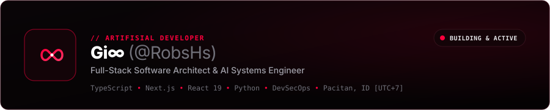

  

  

  
  
  
  

  <code>[ <a href="#-01--about--the-artifisial-developer">01 // ABOUT</a> ]</code> •
  <code>[ <a href="#-02--curated-engineering-projects">02 // PROJECTS</a> ]</code> •
  <code>[ <a href="#%EF%B8%8F-03--core-technical-arsenal">03 // TECH STACK</a> ]</code> •
  <code>[ <a href="#-04--telemetry--activity-metrics">04 // TELEMETRY</a> ]</code> •
  <code>[ <a href="#-05--connect--collaborate">05 // CONNECT</a> ]</code>

---

## ⚡ 01 // About — The Artifisial Developer

Hi, I'm **Gi∞ (@RobsHs)**. I engineer software under the brand of **Artifisial Developer** — an AI-augmented full-stack architect based in Pacitan, Indonesia, operating at the frontier where **human architectural rigor** meets the **exponential velocity of modern artificial intelligence**.

I believe AI is not a crutch for bad code; it is a **force multiplier for elite engineering**. By orchestrating state-of-the-art neural models, autonomous coding agents, and automated DevSecOps pipelines into a disciplined engineering workflow, I design, prototype, and ship scalable, production-ready systems at unprecedented velocity.

> **The Artifisial Developer Philosophy**  
> _"Architecture guided by human craftsmanship, accelerated by machine intelligence. Clean, typed, maintainable, and built for real-world resilience."_

### ✦ Core Engineering Specializations

- 🧠 **AI-Augmented System Engineering**: Orchestrating frontier AI models (Google Gemini 3.8, Claude 3.7, Deep Agentic Pipelines) to accelerate complex architectural spikes, automated security analysis, and intelligent web integrations.
- ⚡ **Modern Full-Stack Architecture & Web OS**: Engineering blisteringly fast, type-safe, and modular platforms utilizing **React 19**, **Next.js 15**, **TypeScript**, and desktop-grade browser simulations ([`MacOS-Web-Simulator`](https://github.com/RobsHs/MacOS-Web-Simulator), [`WIN98`](https://github.com/RobsHs/WIN98)).
- 🛡️ **DevSecOps & Systems Engineering**: Authoring high-speed security exposure auditors ([`AegisScan`](https://github.com/RobsHs/AegisScan)), AST security parsers ([`PyAST-Guard`](https://github.com/RobsHs/pyast-guard)), and native Win32 C++ shell modifications ([`custom-start-button`](https://github.com/RobsHs/custom-start-button)).

---

## 🚀 02 // Curated Engineering Projects

  <b>SELECTED PRODUCTION SYSTEMS &amp; OPEN-SOURCE TOOLING</b>

| System &amp; Project | Technical Overview &amp; Capabilities | Technology Matrix | Gateway Access |
| :--- | :--- | :--- | :---: |
|  <b>macOS Simulator</b> | <b>macOS Sequoia Next-Gen Web Simulator</b> Authentic browser-based macOS Sequoia desktop environment featuring sub-frame window physics, Monaco-powered VS Code editor, interactive terminal, Leaflet Maps with GPS geolocation, procedural Web Audio synthesizer, and Google Gemini AI integration. | `React 19` `Vite 7` `Tailwind CSS 4` `Zustand` | [⚡ **LIVE DEMO**](https://macos-me.web.app) [📦 **SOURCE REPO**](https://github.com/RobsHs/MacOS-Web-Simulator) |
|  <b>DevAtlas</b> | <b>Computer Science Knowledge &amp; System Design Engine</b> Open-source, zero-dependency algorithm &amp; data structure library (100+ modules), system design architectural patterns, and interactive visual web dashboard with terminal CLI explorer. | `Node.js` `Zero-Dep` `System Design` `Algorithms` | [📦 **SOURCE REPO**](https://github.com/RobsHs/devatlas) |
|  <b>OmniTools Ultimate</b> | <b>Full-Stack Developer Suite &amp; Zero-Mock Media Engine</b> Production-grade developer utility platform featuring iOS 26 Liquid-Glass aesthetics, zero-mock backend computation, media transcoding pipelines, and Google Gemini AI Flash neural telemetry. | `Node.js 20+` `Express v5` `Tailwind CSS` `Gemini AI` | [📦 **SOURCE REPO**](https://github.com/RobsHs/omnitools-ultimate) |
|  <b>SIMRS Healthcare</b> | <b>Clinical EMR &amp; Hospital Management System</b> Production-grade hospital operational platform compliant with Permenkes 24/2022 &amp; UU PDP. Features structured SOAP electronic medical records, ICD-10 diagnostic engine, automated FEFO pharmacy dispensing, and 500+ unit test suite. | `Node.js 24` `SQLite WAL` `Express` `Permenkes 24/22` | [📦 **SOURCE REPO**](https://github.com/RobsHs/simrs-dashboard) |
|  <b>EXCEKUTOR</b> | <b>Enterprise QR Attendance &amp; Cloud Analytics Engine</b> Real-world digital presence management system engineered for SMKN 1 Pacitan featuring single-scan QR session authentication, real-time Cloud Firestore synchronization, high-DPI Bento Grid analytics, and iOS 26 Liquid-Glass design architecture. | `React 19` `TypeScript` `Firebase` `Tailwind CSS` | [📦 **SOURCE REPO**](https://github.com/RobsHs/EXCEKUTOR) |
|  <b>Custom Start Mod</b> | <b>Low-Level Windows Shell &amp; Taskbar Customizer</b> Native C++ Windhawk modification hook for Windows 10 &amp; 11 replacing system start button. Implements Win32 `Shell_TrayWnd` subclassing, Taskbar XAML Island visual tree traversal, DirectComposition rendering, and hardware-accelerated clipping. | `C++20` `Win32 API` `XAML Island` `Windhawk` | [📦 **SOURCE REPO**](https://github.com/RobsHs/custom-start-button) |
|  <b>WIN98 Sandbox</b> | <b>Interactive Retro OS Simulation (Win98)</b> Browser-based retro operating system sandbox featuring reactive window management, virtual filesystem explorer, vintage interactive components, and classic games in modern React. | `TypeScript` `React 19` `Tailwind CSS` `Vite` | [⚡ **LIVE DEMO**](https://jendela98.vercel.app) [📦 **SOURCE REPO**](https://github.com/RobsHs/WIN98) |
|  <b>PyAST-Guard</b> | <b>AST-Powered Static Application Security Testing (SAST)</b> High-performance Python AST lexical parser detecting OWASP Top 10 vulnerabilities (SQLi, Command Injection, Insecure Deserialization) with native SARIF 2.1.0 GitHub Security integration. | `Python 3.12` `Python AST` `OWASP Top 10` `SARIF 2.1.0` | [📦 **SOURCE REPO**](https://github.com/RobsHs/pyast-guard) |
|  <b>AegisScan</b> | <b>Web Posture &amp; Exposure Audit Engine</b> Asynchronous security scanner auditing HTTP security headers, sensitive exposed endpoints, secret leakage, and OWASP Top 10 vulnerabilities with automated CI/CD integration. | `Python 3.12` `OWASP Top 10` `AsyncIO` `DevSecOps` | [📦 **SOURCE REPO**](https://github.com/RobsHs/AegisScan) |
|  <b>QR-PRO</b> | <b>Neural QR Studio &amp; Scanner</b> AI-augmented QR generation suite featuring canvas rasterization, fine-grained aesthetic customization, prompt telemetry, and instant bulk vector export. | `TypeScript` `React 19` `Gemini AI` `Tailwind CSS` | [⚡ **LIVE DEMO**](https://qr-pro-ten.vercel.app) [📦 **SOURCE REPO**](https://github.com/RobsHs/QR-PRO) |
|  <b>CMAKER</b> | <b>Cryptographic Certificate Studio</b> WYSIWYG credential design and verification studio with CSV batch generation, 300 DPI vector PDF export, and instant public authenticity verification. | `TypeScript` `React 19` `Tailwind CSS` `jsPDF` | [⚡ **LIVE DEMO**](https://cmakers.vercel.app/) [📦 **SOURCE REPO**](https://github.com/RobsHs/CMAKER) |
|  <b>SmartNotes Enterprise</b> | <b>Encrypted Knowledge &amp; Document Vault</b> Enterprise note-taking backend architecture featuring cryptographic storage models, relational schemas, and low-latency RESTful APIs. | `Python` `SQLAlchemy` `FastAPI` `PostgreSQL` | [📦 **SOURCE REPO**](https://github.com/RobsHs/SmartNotes_Enterprise) |

  <i>Explore all repositories, forks, and experimental modules on the <a href="https://github.com/RobsHs?tab=repositories">RobsHs Repository Grid</a>.</i>

---

## 🛠️ 03 // Core Technical Arsenal

### 💻 Languages &amp; Runtimes

  

### 🌐 Frontend &amp; Client Architecture

  

### ⚙️ Backend, Persistence &amp; Cloud Infrastructure

  

### 🧠 AI Engineering &amp; Agentic Ecosystem

  
  
  
  
  

### 🧰 Development Tools &amp; Operations

  

---

## 📊 04 // Telemetry &amp; Activity Metrics

  
  

  

---

## 🐍 04.1 // Contribution Stream &amp; Activity Graph

  <code>[ CONTINUOUS ACTIVITY // 650+ DAYS COMMITS RUNTIME ]</code>

  

---

## 🌐 05 // Connect &amp; Collaborate

Interested in building intelligent web systems, collaborating on open-source software, or discussing full-stack architecture? Reach out through any channel below:

  
  
  
  

---

  

  <a href="#top">
    <code>[ ⬆ BACK TO TOP ]</code>
  </a>

